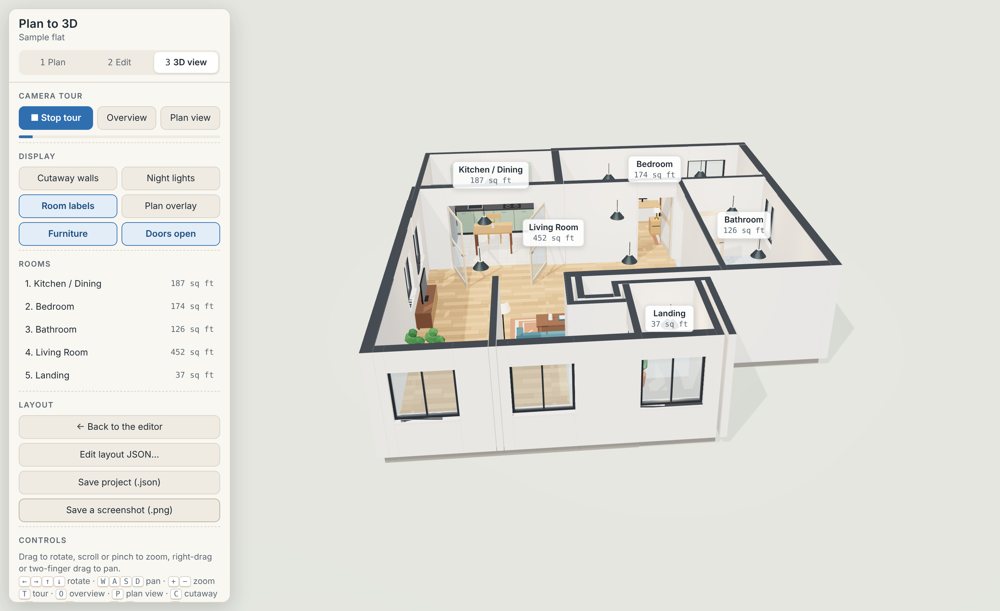
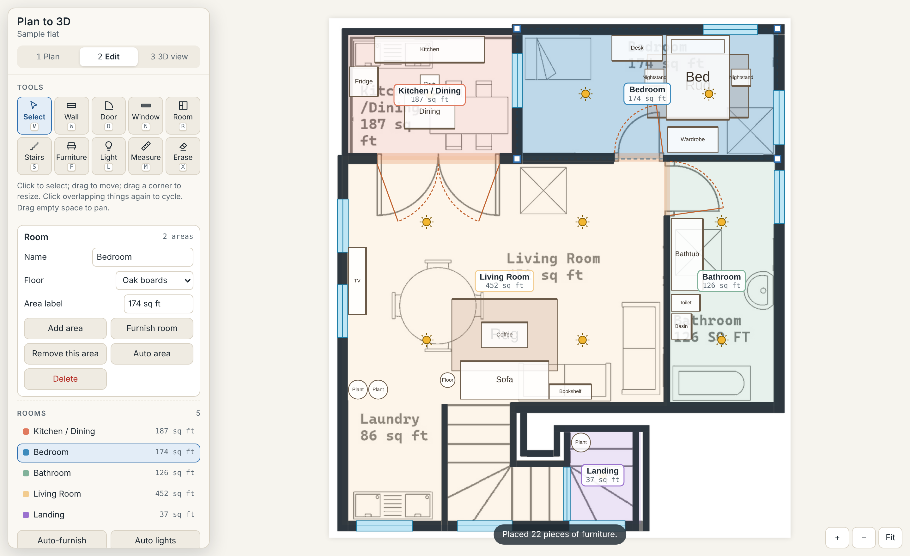

# Plan to 3D

A single-page web app that turns a floor plan (image or PDF) into a 3D model you can tour.

## Use it

Open `index.html` in a modern browser (Chrome, Edge, Firefox, Safari). No install and no server needed; it loads Three.js, pdf.js and tesseract.js from public CDNs. Your plan is processed in the browser and is not uploaded anywhere.

1. **Plan**: drop in a PNG, JPG, WebP, GIF or PDF (or try the built-in sample).
2. **Edit**: the app detects walls, doors (with hinge and swing), windows and rooms, and reads room names and areas printed on the plan. Fix anything with the tools (wall, door, window, room, stairs, furniture, light, measure, erase), set the scale from the overall width or a known length, and use **Auto-furnish** to furnish rooms by name.
3. **3D view**: camera tour, overview, plan view, cutaway walls, night lights, room labels, plan overlay, furniture and door toggles, room fly-to, layout JSON editor, project save and screenshot.

Tips: plans with solid dark walls on a light background work best. If walls are drawn as two thin lines, tick **Walls drawn as outlines** and press Re-detect. The first scale is a guess from wall thickness, so check it under **Scale**.

## Source

`index.html` is built from the files in `source/`:

| File | Contents |
| --- | --- |
| `head.html` | Page markup and styles |
| `sample.js` | Sample plan image and its hand-measured layout |
| `core.js` | Three.js scene, materials, furniture models, layout → 3D builder, camera tour |
| `detect.js` | Wall, door, window and room detection |
| `app.js` | Upload, 2D editor, auto-furnish, room-name reading, 3D view wiring |

Rebuild after editing: `python3 source/build.py`

## Layout format

Units are plan-image pixels; `scale` is metres per pixel. Walls and windows are `[x0, y0, x1, y1]` rectangles; doors are `{rect, hinge: start|end|both, swing: ±1, open, style}`; rooms are `{name, area, floor, rects}`; plus `stairs`, `furniture`, `lights` and an optional `tour`. Edit it live from the 3D view's **Edit layout JSON** dialog.
